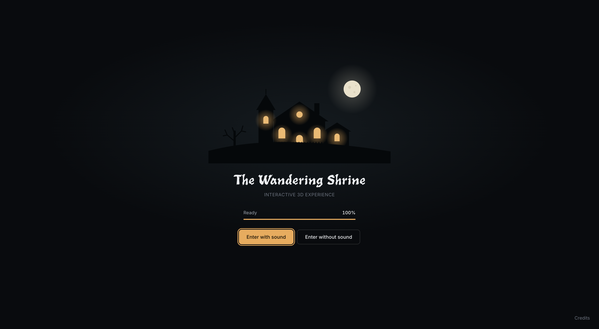
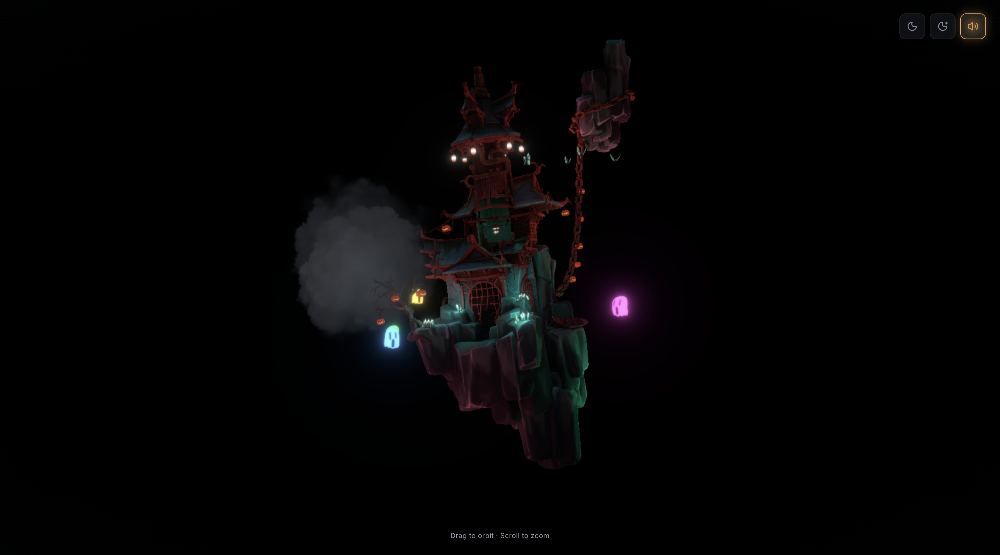
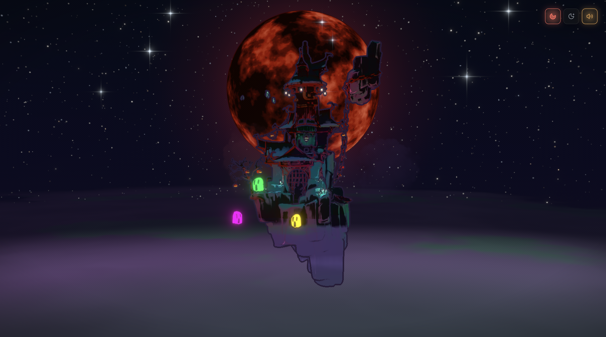
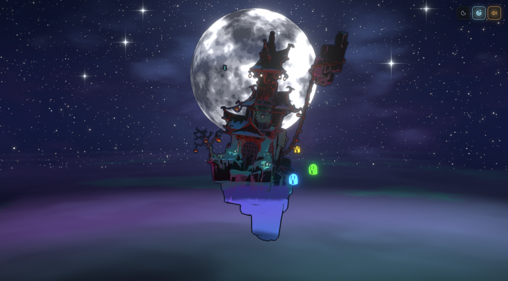

# Haunted House 👻🏚️

A spooky 3D web experience built with **React Three Fiber**,
**Three.js**, and **Blender**. Explore a haunted environment featuring
atmospheric visuals and moon variations.

🔗 **Live Demo:** https://haunted-house-u86c.vercel.app/

## Main Features

-   Interactive 3D haunted-house environment.
-   Blood moon and white moon visual variations.
-   Atmospheric lighting and spooky effects.
-   Ghosts, smoke, and animated bats.
-   Background music.
-   Custom loading screen.
-   3D graphics rendered directly in the browser.

## Project Outputs

### Loading Screen



### Normal Scene




### Blood Moon



### White Moon




## Clone and Run Locally

### 1. Clone the repository

Replace `https://github.com/Anuj0720/Haunted-House` with your GitHub repository URL.

``` bash
git clone https://github.com/Anuj0720/Haunted-House.git
cd haunted house
```

### 2. Install dependencies

``` bash
npm install
```

### 3. Start the development server

``` bash
npm run dev
```

Open the local URL shown in your terminal.

> If `npm run dev` is not available, check the scripts in `package.json`
> and use the development command configured for your project.
